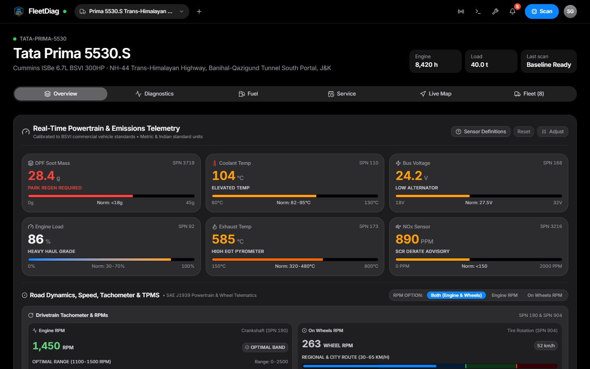
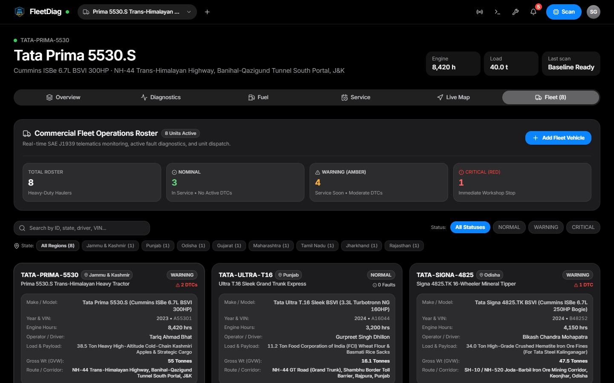
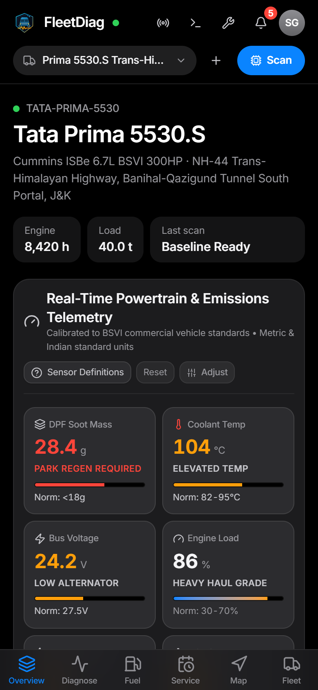
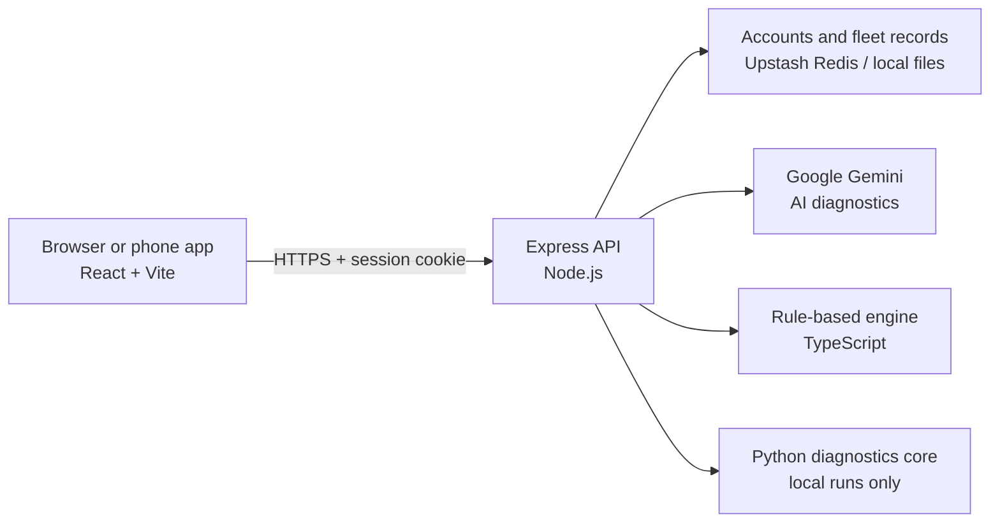

# FleetDiag AI

**Live site:** https://fleet-diagnostic-ai.vercel.app

FleetDiag AI is a web app for diagnosing and maintaining heavy-duty commercial trucks. It shows engine and emissions readings, explains fault codes, predicts upcoming maintenance, estimates fuel losses and tracks vehicles on a map. It's built as a college minor project and focuses on Tata Motors BS-VI vehicles.



| Fleet roster | On a phone |
| --- | --- |
|  |  |

## Features

- **Live telemetry:** engine, emissions, speed, tyre pressure and DPF soot readings, each with normal, warning and critical ranges.
- **AI diagnostics:** a health score, likely causes, repair steps and required parts for each vehicle.
- **Fault code library:** 95 Tata Motors BS-VI trouble codes with causes and workshop procedures.
- **Fuel analysis:** current economy against a baseline, and the estimated monthly cost of the difference.
- **Maintenance forecast:** upcoming service tasks with estimated costs in rupees.
- **Technician copilot:** answers workshop questions about the selected vehicle.
- **Fleet tools:** a searchable roster, printable work orders and a live map.
- **Roles:** developer, fleet director, fleet manager, technician and dispatcher each see only what they need.
- **Works everywhere:** responsive layout, light and dark themes, and installable on a phone.

### What's real and what's simulated

Telemetry comes from a built-in simulator and sample fleet data, not from physical trucks. Diagnostics use Google Gemini when `GEMINI_API_KEY` is set. Without a key, the app falls back to a rule-based engine, which is also what the Python core uses.

## How it works



The browser never connects to a database. Everything goes through the API, which checks the signed-in user first.

| Part | Technology |
| --- | --- |
| Frontend | React 19, TypeScript, Vite, Tailwind CSS |
| Backend | Node.js, Express |
| Storage | Upstash Redis on Vercel, JSON files locally |
| AI | Google Gemini, with a rule-based fallback |
| Diagnostics core | Python 3, standard library only |
| Hosting | Vercel (static site and a serverless function) |
| Tests | Vitest, Supertest, GitHub Actions |

## Run it locally

You need Node.js 22 or later. Python 3 is optional and enables the Python diagnostics core.

```bash
npm install
cp .env.example .env
npm run dev
```

Then open http://localhost:3000.

Set `FLEETDIAG_PASSWORD_DEVELOPER` and the other `FLEETDIAG_PASSWORD_<ROLE>` values in `.env` before the first run. Any role you leave empty gets a random password, printed once in the terminal. Passwords are only read when the accounts are first created, in `data/auth/`. To start again with new passwords, delete that folder.

## Settings

Copy `.env.example` to `.env`, which git ignores. Never commit real values.

| Variable | Needed | What it does |
| --- | --- | --- |
| `FLEETDIAG_PASSWORD_<ROLE>` | On Vercel | Password for each built-in account. A role left empty can't sign in there. |
| `SESSION_SECRET` | Recommended | Signs session cookies. Use 32 or more random characters. |
| `UPSTASH_REDIS_REST_URL`, `UPSTASH_REDIS_REST_TOKEN` | On Vercel | Permanent storage. Without them, data resets whenever the function restarts. |
| `GEMINI_API_KEY` | Optional | Turns on AI diagnostics. Stays on the server. |
| `VITE_GOOGLE_MAPS_API_KEY` | Optional | Turns on the map. This key reaches the browser, so restrict it by website in Google Cloud. |
| `TRUST_PROXY` | Behind a proxy | Number of proxies, so rate limits see real visitor addresses. Automatic on Vercel. |
| `OTP_DEMO_MODE` | Optional | Shows reset codes on screen for local demos. Always off on the live site. |

## Deploy to Vercel

1. Import this repository into Vercel. `vercel.json` already sets the build.
2. Add the `FLEETDIAG_PASSWORD_<ROLE>` variables and `SESSION_SECRET`. Tick **Preview** as well as **Production** if you want to sign in on preview deployments.
3. Connect **Upstash for Redis** from the Vercel Marketplace.
4. Redeploy, because new variables only apply to new deployments.

To confirm, sign in and visit `/api/storage-status`: it should say `"persistent": true`. If it says `false`, Upstash isn't connected, and sign-in rate limits and lockouts only count per server instance.

**Locked out of an account?** If a customer's owner is locked out, sign in as a developer, open the fleet button in the header, press Add user on that fleet, and add a replacement with the Fleet Owner role.

### Deploying

Fleets are now stored one record per fleet. The first time a new deployment starts, it copies the old single fleet list (`fleetdiag_fleets_v1`) across and never changes that list again. Each later cold start also copies any fleet that is in the old list but missing from the new records, and never overwrites a fleet that is already there.

- **Don't create or suspend fleets while a deployment is rolling out.** Old and new instances can serve requests at the same time, and a change made on one of them may not be seen by the other.
- **Rolling back past this change.** The old code reads only the old list, so check the fleet list in the developer Fleets screen afterwards. Fleets created after this change are missing from the old list.
- **Suspensions made while rolled back.** The old code writes them only to the old list. The new code never copies a status for a fleet it already has, so re-apply those suspensions by hand after deploying forward again.

**Last resort, before you have customers only.** Deleting the `fleetdiag_users_v2` key in the Upstash console and redeploying removes every account of every fleet, including all customer owners and staff, along with their security answers. Only the built-in accounts come back, from your Vercel variables. Upstash is the only copy of customer data, so there is no backup to restore from.

## Fleets

Each customer has its own fleet, and people only see the vehicles and data of the fleet they belong to.

- **Demo fleet.** A built-in fleet for trying the app. It is the only one where the simulated telemetry stream can run, and it can't be suspended.
- **Creating a customer.** Sign in as a developer, open the fleet button in the header, and fill in "Add a customer fleet" with the fleet name and the owner's name and email. A temporary password for the owner is shown once, with a copy button. It isn't stored or shown again, so pass it on before closing the window.
- **Suspending a customer.** In the same screen, press Suspend on a fleet and confirm. Press Reactivate to restore it.
- **Switching fleets.** A developer presses "Switch to this fleet" to view another fleet. The page reloads, and the header shows which fleet you are in. Switch back to the Demo fleet the same way.

## Security

- Passwords and security answers are stored only as salted scrypt hashes, and none are kept in this repository.
- Sessions use signed, HttpOnly, SameSite=Strict cookies, and changing a password signs out old sessions.
- Every API route needs a session except sign-in, password reset and the health check. Admin routes also need the developer permission.
- Accounts lock after 5 wrong attempts, and sign-in and AI routes are rate-limited.
- Password reset on the live site uses each person's own security questions.
- Requests are checked for size, valid data, prototype pollution and script injection.

The threat model is in [security_spec.md](security_spec.md). To report a vulnerability, follow [SECURITY.md](SECURITY.md); please don't open a public issue.

### Account lockout

- Five wrong passwords in a row lock the account for 5 minutes, even for the right password. A correct sign-in clears the count, and wrong attempts are forgotten 4 minutes after the first.
- A browser that has signed in to the account before is not locked out by other people's attempts. On each successful sign-in it gets a known-device cookie (`fd_device`, 180 days, HttpOnly, SameSite=Strict, sent only to the sign-in page). It is signed by the server, can only be obtained with the right password, and is not a session: it gives no access by itself.
- On a known browser, wrong passwords count against that browser only. Five of them lock that browser for 5 minutes and nobody else.
- Signing out keeps the cookie. Changing or resetting the password cancels every known-device cookie for the account.
- **What it does not cover:** someone on a new browser, or one that has cleared its cookies, during an attack is still locked out like anyone else. They can wait 5 minutes or reset their password. Password reset by security questions has its own lock, and it does not know about devices.

## Tests

```bash
npm test        # unit and API tests
npm run lint    # type-check
```

The API tests run attacks against the real server, including forged sessions, permission bypasses, path traversal and password reset abuse. One test file loads the server exactly as the live site runs it. GitHub Actions runs everything on each push to `dev` and `main`, installing exactly what `bun.lock` lists. CodeQL code scanning and the OpenSSF Scorecard workflow also run once the repository is public, and Dependabot proposes dependency updates weekly.

## Project layout

```text
server.ts          API routes and diagnostics logic
server/            Accounts, sessions, storage and the Vercel entry point
src/components/    Screens and panels
src/services/      Browser code that calls the API
src/data/          Sample fleet and the fault code catalogue
python/            Python diagnostics core
tests/             Unit and API tests
public/            Icons, app manifest, service worker and the project synopsis PDF
```

## Author

Sarthak Gohil

## License

[MIT](LICENSE)
